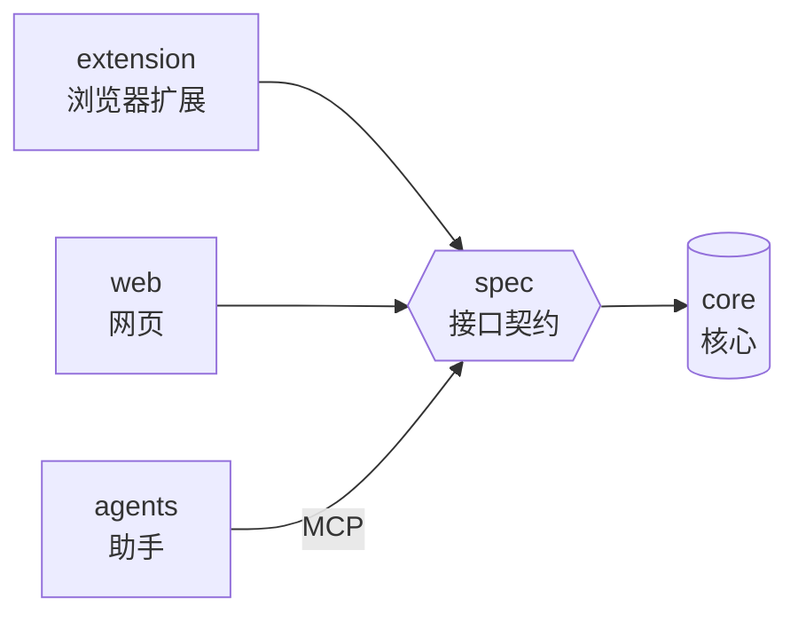

# KeepEssence

**AI 根据你的需求，帮你筛选，为你内化。**
AI that filters what you save against your own needs, and helps you internalize what is worth keeping.

你把链接、文字、图片存进来；助手（agent）逐条解读，每天汇成一份每日摘要；值得的条目你和 AI 深挖，留下笔记。存进来的原件会过期，留下的只有每日摘要和笔记。

KeepEssence 的核心和各个客户端是开源的，你可以自己部署一套。

## 仓库

| 仓库 | 内容 | 状态 |
|---|---|---|
| [spec](https://github.com/KeepEssenceApp/spec) | 产品规格、接口契约（OpenAPI 3.1）、验收标准、UX mock。所有平台照它做，先读这里 | 1.x |
| [core](https://github.com/KeepEssenceApp/core) | 核心（服务器）：Cloudflare Workers、D1、R2。HTTP API、MCP 端点、授权、内置助手 | 1.x，内测中 |
| [web](https://github.com/KeepEssenceApp/web) | 网页应用：读每日摘要和笔记、网页收件箱、管理助手和设备；可以装到手机上 | 1.x，内测中 |
| [extension](https://github.com/KeepEssenceApp/extension) | 浏览器扩展：把网页、文字、链接、图片存进来 | 1.x，内测中 |
| [ios](https://github.com/KeepEssenceApp/ios) | iPhone App 和分享扩展 | 1.x，模拟器里验过，真机待验 |
| [agents](https://github.com/KeepEssenceApp/agents) | 助手接入：各家的连接器指南、自部署的定时型助手示例 | 1.x |
| [site](https://github.com/KeepEssenceApp/site) | 官网 www.keepessence.app | 可用 |

所有平台只经契约和核心说话，互不知道对方存在。做的顺序：契约 → 核心 → 助手的接口 → 网页 → 存入的客户端。

## 参与

- 想法、问题、缺陷：到对应仓库开 issue；不确定归哪个仓库，开在 [spec](https://github.com/KeepEssenceApp/spec/issues)。
- 提交代码：看 [贡献指南](https://github.com/KeepEssenceApp/.github/blob/main/CONTRIBUTING.md)。
- 安全问题：不要开公开 issue，看 [安全说明](https://github.com/KeepEssenceApp/.github/blob/main/SECURITY.md)。

代码以 [AGPL-3.0](https://www.gnu.org/licenses/agpl-3.0.html) 发布。
